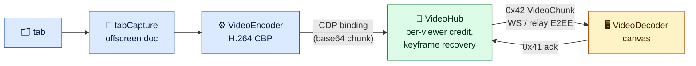

# Server browser video: research and trial

Working note, 2026-11-11, branch `research/server-browser-video-stream`. It records why the server browser should stream tabs as video, what was measured, and the design to build. If we build it, fold the design into [server-browser.md](server-browser.md) and delete this file.

## Result

Stream a tab as H.264 from Chrome's own tab capture. A small extension the daemon loads over CDP captures the tab with `chrome.tabCapture`. Its offscreen document encodes the frames with WebCodecs `VideoEncoder` and hands the chunks to the daemon through a CDP binding. The daemon sends them over the existing WebSocket and relay as a new binary frame. The web viewer decodes them with WebCodecs onto a canvas.

On the same workloads, against today's JPEG screencast:

- **Bandwidth drops 8–15×**: 2.6–4 Mbit/s instead of 25–46 Mbit/s at the same 55–60 fps.
- **On a constrained link, video keeps 60 fps where JPEG falls to about 19.** JPEG is held back by its ack window and the bytes. See [In the app](#in-the-app).
- **Latency is the same on a fast link** (40–70 ms p50) and lower on a slow one.
- **Daemon CPU drops.** The daemon relays 3 Mbit/s instead of 30–45, so relay encryption has less to do. Chrome's CPU is about the same: tab capture plus software H.264 costs what JPEG encoding costs.
- **The viewer spends about half the CPU** of decoding 60 JPEGs a second.

It runs on Managed Chrome, both Window and Headless modes. It does not run on chrome-headless-shell, which is what Headless (light) uses today, or on an Existing browser. Those keep JPEG, and every viewer falls back to JPEG on its own.

## Candidates

| Candidate                                                                 | Headless                                                                                                      | Scope                                   | Codec, where it encodes                                                | Input path                 | Licence, upkeep                                              | Over our WebSocket and relay             | Verdict                                                                                 |
| ------------------------------------------------------------------------- | ------------------------------------------------------------------------------------------------------------- | --------------------------------------- | ---------------------------------------------------------------------- | -------------------------- | ------------------------------------------------------------ | ---------------------------------------- | --------------------------------------------------------------------------------------- |
| **Extension `chrome.tabCapture` + WebCodecs** (prototyped)                | `--headless=new` and headed: yes. chrome-headless-shell: no (verified)                                        | one tab; survives navigation (verified) | H.264 (OpenH264), VP8/VP9/AV1, software, in Chrome's offscreen process | unchanged: CDP `Input.*`   | Chrome APIs; ours to maintain (about 150 lines of extension) | yes: CDP binding → daemon → binary frame | **Pick**                                                                                |
| In-page `getDisplayMedia({preferCurrentTab})` + WebCodecs                 | `--headless=new` with `--auto-accept-this-tab-capture`: yes (verified); shell: `NotSupportedError` (verified) | one tab; **dies on every navigation**   | same encoders, in the page's renderer                                  | unchanged                  | Chrome APIs                                                  | yes                                      | Fallback idea only: restarts per page and runs in the page                              |
| CDP `Cast.startTabMirroring`                                              | needs a Media Router sink                                                                                     | tab                                     | Cast Streaming (RTP) to a sink                                         | –                          | experimental domain                                          | no: RTP over UDP to a Cast receiver      | Dead end [1]                                                                            |
| `HeadlessExperimental.beginFrame`                                         | old headless only                                                                                             | tab                                     | still images (PNG/JPEG/WebP)                                           | –                          | `enable`/`disable` deprecated                                | same as JPEG today                       | No gain over screencast [9]                                                             |
| puppeteer-stream                                                          | `--headless=new`                                                                                              | tab                                     | MediaRecorder WebM at a timeslice                                      | –                          | MIT, active (3.0.23, 2026-07)                                | its own local ws                         | Same capture as ours, but container chunks add latency and give no keyframe control [7] |
| Re-encode CDP JPEG to H.264 on the daemon (ffmpeg/x264)                   | every engine                                                                                                  | tab                                     | x264 on the daemon after a JPEG decode                                 | unchanged                  | x264 is GPL (ffmpeg on PATH)                                 | yes                                      | Measured below: 0.8–0.9 extra cores, 70–180 ms p50, p99 up to 4 s                       |
| voxl (baseline)                                                           | needs a real X display (Xvfb); no headless                                                                    | the whole display                       | x264 `ultrafast`, adaptive bitrate                                     | its own, injected into X11 | MIT code, GPL binary (x264); x264/libyuv/opus/pulse          | its own WebSocket server                 | Not tab-level; not built here (see below) [16]                                          |
| Hosted products (Browserless, Browserbase, Steel, Hyperbeam, Kernel, ...) | –                                                                                                             | screencast, or whole display            | JPEG screencast, or WebRTC from the display                            | –                          | –                                                            | WebRTC needs UDP/TURN                    | None ships tab-level video over CDP [10–15]                                             |

Details that decided it:

- **Loading the extension.** Branded Chrome ignores `--load-extension` from 137 on [5][6]. CDP `Extensions.loadUnpacked` replaces it, and needs `--enable-unsafe-extension-debugging` with CDP over a pipe. Verified on Chrome 153 and Playwright's Chromium 1208. The daemon already speaks CDP over a pipe to the engines it launches. An Existing browser was started by its owner without the flag, so it cannot load the extension.
- **No user gesture.** `tabCapture.getMediaStreamId` needs the user to have invoked the extension, unless `--allowlisted-extension-id` names it [2][3]. Without the flag it throws "Extension has not been invoked for the current page" (verified). The manifest's `key` pins the id. `chrome.debugger.getTargets()` maps a CDP target id to the tab id; it never attaches, so it shows no debugging bar.
- **chrome-headless-shell** has no `Extensions` domain, and `getDisplayMedia` throws `NotSupportedError` (both verified). Headless (light) gets video only by running Playwright's full Chromium with `--headless=new`. That Chromium (Chrome for Testing) encodes H.264 (verified).
- **Navigation.** Capture continues across navigations of the tab, cross-origin included (verified, and [2]).
- **Native viewers.** WebCodecs `VideoDecoder` exists in iOS WKWebView from 16.4 and in Android System WebView from 94 [17][18]. The React Native app has no WebCodecs, so a phone needs a WebView player or a native decoder: VideoToolbox (`AVSampleBufferDisplayLayer`) on iOS, `MediaCodec` on Android. No maintained React Native library does this; a local Expo module is the reference design [19][20]. Constrained Baseline H.264 decodes in hardware on every phone.

Nobody else streams tab-level video over CDP in public except ace (PR #1082), which ships the same extension pattern [3]. t3code tried it and closed the PR [4].

## Measurements

The page paints `Date.now()` as a 40-bit barcode into a fixed canvas on every animation frame. The viewer reads the barcode from each frame it puts on screen. Latency is from the page painting a frame to that frame being on the viewer's screen. Viewer and daemon run on the same host, so they share one clock. fps is frames shown per second: the worst full second, then the median. Workloads, 1280×800 page:

- **anim**: twelve squares moving and rotating with CSS animations, and a block of text.
- **long**: a 400-section page scrolling 6 px per frame.

CPU is the percentage of one core over the window, from `/proc/<pid>/stat` of the process tree. Everything runs at nice 10 on the shared 16-core box. The load average is next to each row, and rows are two runs each. The box was loaded (load 5–15) during the standalone runs; outliers are kept, and the analysis uses the better run of each pair.

### Standalone (no daemon)

A Node script drives Chrome over CDP and serves a WebSocket. A second headless Chromium decodes and reads the barcode. JPEG uses the daemon's real `ScreencastHub` (window of 2, quality 60). Re-encode feeds the screencast JPEGs to ffmpeg's x264 (`ultrafast`, `zerolatency`, 4 Mbit/s target). The source script is `scripts/server-browser-video-bench/standalone/bench.mjs`.

| Workload | Method          | Engine                     | Codec     | fps worst / median | Latency p50 / p99 | Mbit/s | Chrome CPU | Daemon CPU | Viewer CPU | Load (1 min) |
| -------- | --------------- | -------------------------- | --------- | ------------------ | ----------------- | ------ | ---------- | ---------- | ---------- | ------------ |
| anim     | JPEG screencast | Chromium 1208 headless=new | jpeg q60  | 60 / 60            | 43 / 69 ms        | 35.5   | 148%       | 8%         | 67%        | 13.48        |
| anim     | JPEG screencast | Chromium 1208 headless=new | jpeg q60  | 58 / 60            | 44 / 72 ms        | 35.2   | 153%       | 8%         | 70%        | 12.03        |
| anim     | JPEG screencast | Chrome 153 headed (Xvfb)   | jpeg q60  | 46 / 59            | 45 / 86 ms        | 32.8   | 150%       | 27%        | 66%        | 10.67        |
| anim     | JPEG screencast | Chrome 153 headed (Xvfb)   | jpeg q60  | 49 / 59            | 46 / 97 ms        | 34.0   | 152%       | 26%        | 68%        | 9.82         |
| anim     | JPEG screencast | Chrome 153 headless=new    | jpeg q60  | 7 / 14             | 118 / 504 ms      | 11.6   | 69%        | 8%         | 25%        | 11.79        |
| anim     | JPEG screencast | Chrome 153 headless=new    | jpeg q60  | 13 / 32            | 79 / 825 ms       | 17.3   | 103%       | 15%        | 37%        | 15.80        |
| anim     | Tab capture     | Chromium 1208 headless=new | H.264 CBP | 55 / 60            | 19 / 110 ms       | 4.0    | 114%       | 7%         | 48%        | 12.25        |
| anim     | Tab capture     | Chromium 1208 headless=new | H.264 CBP | 47 / 56            | 61 / 141 ms       | 3.6    | 115%       | 6%         | 50%        | 11.94        |
| anim     | Tab capture     | Chrome 153 headed (Xvfb)   | H.264 CBP | 59 / 60            | 51 / 66 ms        | 4.0    | 121%       | 7%         | 48%        | 8.82         |
| anim     | Tab capture     | Chrome 153 headed (Xvfb)   | H.264 CBP | 58 / 60            | 50 / 83 ms        | 4.0    | 130%       | 7%         | 52%        | 8.75         |
| anim     | Tab capture     | Chrome 153 headless=new    | H.264 CBP | 15 / 50            | 730 / 2670 ms     | 3.8    | 130%       | 7%         | 50%        | 11.05        |
| anim     | Tab capture     | Chrome 153 headless=new    | H.264 CBP | 57 / 59            | 66 / 95 ms        | 3.9    | 133%       | 6%         | 55%        | 14.13        |
| anim     | Tab capture     | Chrome 153 headless=new    | vp8       | 41 / 56            | 85 / 318 ms       | 3.8    | 234%       | 7%         | 51%        | 15.16        |
| anim     | Tab capture     | Chrome 153 headless=new    | vp8       | 60 / 60            | 37 / 85 ms        | 4.3    | 156%       | 7%         | 53%        | 12.48        |
| anim     | JPEG → x264     | Chrome 153 headless=new    | x264      | 56 / 60            | 96 / 186 ms       | 9.3    | 156%       | 87%        | 53%        | 14.67        |
| anim     | JPEG → x264     | Chrome 153 headless=new    | x264      | 50 / 59            | 69 / 185 ms       | 9.4    | 148%       | 82%        | 51%        | 12.10        |
| long     | JPEG screencast | Chromium 1208 headless=new | jpeg q60  | 58 / 60            | 45 / 77 ms        | 46.7   | 151%       | 28%        | 72%        | 6.05         |
| long     | JPEG screencast | Chromium 1208 headless=new | jpeg q60  | 51 / 57            | 44 / 64 ms        | 44.2   | 139%       | 29%        | 65%        | 5.76         |
| long     | JPEG screencast | Chrome 153 headed (Xvfb)   | jpeg q60  | 27 / 59            | 45 / 237 ms       | 41.7   | 137%       | 23%        | 65%        | 7.74         |
| long     | JPEG screencast | Chrome 153 headed (Xvfb)   | jpeg q60  | 41 / 59            | 58 / 81 ms        | 43.1   | 143%       | 29%        | 67%        | 5.10         |
| long     | JPEG screencast | Chrome 153 headless=new    | jpeg q60  | 49 / 60            | 59 / 162 ms       | 44.1   | 133%       | 27%        | 67%        | 7.93         |
| long     | JPEG screencast | Chrome 153 headless=new    | jpeg q60  | 28 / 59            | 77 / 145 ms       | 38.9   | 134%       | 29%        | 63%        | 9.14         |
| long     | Tab capture     | Chromium 1208 headless=new | H.264 CBP | 54 / 59            | 60 / 130 ms       | 2.7    | 131%       | 6%         | 53%        | 6.81         |
| long     | Tab capture     | Chromium 1208 headless=new | H.264 CBP | 57 / 60            | 33 / 68 ms        | 2.7    | 112%       | 5%         | 42%        | 5.29         |
| long     | Tab capture     | Chrome 153 headed (Xvfb)   | H.264 CBP | 53 / 59            | 55 / 152 ms       | 2.7    | 135%       | 5%         | 48%        | 8.56         |
| long     | Tab capture     | Chrome 153 headed (Xvfb)   | H.264 CBP | 59 / 60            | 49 / 72 ms        | 2.7    | 120%       | 6%         | 42%        | 4.82         |
| long     | Tab capture     | Chrome 153 headless=new    | H.264 CBP | 48 / 58            | 64 / 143 ms       | 2.6    | 119%       | 5%         | 46%        | 7.57         |
| long     | Tab capture     | Chrome 153 headless=new    | H.264 CBP | 59 / 60            | 50 / 73 ms        | 2.7    | 120%       | 5%         | 44%        | 8.38         |
| long     | Tab capture     | Chrome 153 headless=new    | vp8       | 60 / 60            | 66 / 89 ms        | 3.5    | 125%       | 5%         | 45%        | 6.85         |
| long     | Tab capture     | Chrome 153 headless=new    | vp8       | 47 / 58            | 66 / 295 ms       | 3.5    | 213%       | 8%         | 55%        | 7.86         |
| long     | JPEG → x264     | Chrome 153 headless=new    | x264      | 55 / 60            | 183 / 4308 ms     | 9.5    | 137%       | 90%        | 47%        | 6.50         |
| long     | JPEG → x264     | Chrome 153 headless=new    | x264      | 56 / 60            | 168 / 2205 ms     | 9.5    | 146%       | 93%        | 49%        | 6.56         |

Read it as:

- **JPEG** reaches 55–60 fps on a direct link, but sends 33–47 Mbit/s. Two Chrome 153 headless JPEG anim runs fell to 7–14 fps at load 12–16; the windowed Chrome and Chromium runs did not.
- **Tab capture H.264** gives the same frame rate at 2.6–4 Mbit/s and about the same Chrome CPU (110–135% against 135–150% for JPEG). The daemon only relays it (5–7%). One run at load 11 (Chrome 153, anim) fell to 15 fps with 730 ms p50; its pair ran at 57/59 fps and 66/95 ms.
- **VP8** costs Chrome more CPU than H.264 (125–234%) for no gain.
- **Re-encoding** adds 0.8–0.9 cores of x264 on the daemon, and its latency is the worst (70–180 ms p50, p99 up to 4.3 s on the scroll). It is the only video path for chrome-headless-shell and an Existing browser, and it is not worth it.

### In the app

The real daemon (built from this branch, Managed Chrome Headless), the real web app (the daemon's bundled web UI) in headless Chromium, and the agent's tab opened through the MCP `browser_new_tab` tool. A probe hook in the app's surface reads the barcode from every frame the surface paints. Three paths:

- **direct**: the app on the daemon's own port.
- **relay**: the app on another origin, paired through a local wrangler relay (`--var PASEO_RELAY_UPSTREAM:`), so every frame is end-to-end encrypted.
- **shaped**: the same relay behind a TCP shaper with 100 ms each way (200 ms RTT) and 20 Mbit/s each way, standing in for a real link. relay.paseo.sh is about 430 ms RTT from this box.

Daemon CPU is the daemon process, Chrome CPU is its Chrome, and viewer CPU is the viewing Chromium. The JPEG rows hide `VideoDecoder` from the app, so it asks for JPEG as an app without video does. Over the relay every frame is encrypted, so the bench counts bytes, not frame types. The last four direct rows repeat two video runs that looked off.

| Path   | Viewer   | Workload | Stream | fps worst / median | Latency p50 / p99 | Mbit/s | Daemon CPU | Chrome CPU | Viewer CPU | Load (1 min) |
| ------ | -------- | -------- | ------ | ------------------ | ----------------- | ------ | ---------- | ---------- | ---------- | ------------ |
| direct | 1440x900 | anim     | JPEG   | 51 / 58            | 47 / 79 ms        | 25.1   | 5%         | 134%       | 158%       | 3.33         |
| direct | 1440x900 | anim     | JPEG   | 29 / 57            | 44 / 92 ms        | 24.0   | 4%         | 129%       | 145%       | 7.10         |
| direct | 1440x900 | anim     | H.264  | 54 / 60            | 39 / 78 ms        | 3.0    | 7%         | 120%       | 83%        | 3.77         |
| direct | 1440x900 | anim     | H.264  | 23 / 44            | 69 / 282 ms       | 2.3    | 7%         | 104%       | 72%        | 6.70         |
| direct | 1440x900 | anim     | H.264  | 56 / 60            | 52 / 96 ms        | 3.0    | 6%         | 116%       | 78%        | 4.27         |
| direct | 1440x900 | anim     | H.264  | 50 / 60            | 35 / 91 ms        | 2.9    | 3%         | 109%       | 75%        | 3.93         |
| direct | 1440x900 | long     | JPEG   | 51 / 57            | 40 / 85 ms        | 33.1   | 5%         | 129%       | 170%       | 4.13         |
| direct | 1440x900 | long     | JPEG   | 42 / 58            | 39 / 80 ms        | 32.7   | 4%         | 127%       | 166%       | 5.98         |
| direct | 1440x900 | long     | H.264  | 22 / 36            | 87 / 301 ms       | 1.9    | 7%         | 97%        | 64%        | 7.96         |
| direct | 1440x900 | long     | H.264  | 53 / 60            | 54 / 104 ms       | 3.0    | 7%         | 125%       | 84%        | 5.16         |
| direct | 1440x900 | long     | H.264  | 58 / 60            | 54 / 84 ms        | 3.0    | 7%         | 125%       | 83%        | 4.20         |
| direct | 1440x900 | long     | H.264  | 59 / 60            | 37 / 61 ms        | 3.0    | 7%         | 127%       | 85%        | 4.28         |
| direct | 390x844  | anim     | JPEG   | 52 / 60            | 32 / 78 ms        | 15.4   | 10%        | 94%        | 77%        | 3.41         |
| direct | 390x844  | anim     | JPEG   | 35 / 56            | 49 / 99 ms        | 13.6   | 11%        | 99%        | 74%        | 7.59         |
| direct | 390x844  | anim     | H.264  | 51 / 58            | 49 / 88 ms        | 1.5    | 3%         | 100%       | 35%        | 4.29         |
| direct | 390x844  | anim     | H.264  | 29 / 60            | 47 / 205 ms       | 1.5    | 2%         | 91%        | 36%        | 6.21         |
| relay  | 1440x900 | anim     | JPEG   | 41 / 49            | 44 / 114 ms       | 21.9   | 34%        | 130%       | 170%       | 6.35         |
| relay  | 1440x900 | anim     | JPEG   | 35 / 48            | 63 / 120 ms       | 20.7   | 38%        | 132%       | 161%       | 5.82         |
| relay  | 1440x900 | anim     | H.264  | 39 / 56            | 58 / 310 ms       | 2.8    | 5%         | 125%       | 86%        | 5.60         |
| relay  | 1440x900 | anim     | H.264  | 50 / 55            | 46 / 108 ms       | 2.8    | 8%         | 121%       | 86%        | 6.86         |
| relay  | 1440x900 | long     | JPEG   | 48 / 56            | 57 / 93 ms        | 32.1   | 46%        | 125%       | 198%       | 5.00         |
| relay  | 1440x900 | long     | JPEG   | 14 / 37            | 56 / 202 ms       | 22.0   | 30%        | 114%       | 154%       | 8.41         |
| relay  | 1440x900 | long     | H.264  | 56 / 60            | 53 / 86 ms        | 3.0    | 8%         | 118%       | 79%        | 4.20         |
| relay  | 1440x900 | long     | H.264  | 51 / 58            | 71 / 138 ms       | 2.9    | 7%         | 123%       | 80%        | 7.50         |
| shaped | 1440x900 | anim     | JPEG   | 17 / 20            | 186 / 265 ms      | 8.3    | 11%        | 105%       | 64%        | 5.14         |
| shaped | 1440x900 | anim     | JPEG   | 17 / 19            | 186 / 297 ms      | 8.2    | 14%        | 100%       | 69%        | 5.06         |
| shaped | 1440x900 | anim     | H.264  | 44 / 59            | 155 / 232 ms      | 2.9    | 13%        | 122%       | 88%        | 4.15         |
| shaped | 1440x900 | anim     | H.264  | 31 / 50            | 167 / 268 ms      | 2.5    | 8%         | 114%       | 85%        | 6.07         |
| shaped | 1440x900 | long     | JPEG   | 12 / 19            | 190 / 247 ms      | 8.4    | 14%        | 72%        | 47%        | 4.39         |
| shaped | 1440x900 | long     | JPEG   | 15 / 17            | 209 / 372 ms      | 10.3   | 15%        | 96%        | 66%        | 9.06         |
| shaped | 1440x900 | long     | H.264  | 56 / 60            | 155 / 176 ms      | 3.0    | 8%         | 117%       | 80%        | 3.95         |
| shaped | 1440x900 | long     | H.264  | 55 / 59            | 144 / 196 ms      | 3.0    | 8%         | 122%       | 85%        | 7.95         |
| shaped | 390x844  | anim     | JPEG   | 17 / 19            | 184 / 367 ms      | 4.9    | 10%        | 78%        | 35%        | 6.29         |
| shaped | 390x844  | anim     | JPEG   | 20 / 22            | 148 / 171 ms      | 5.6    | 5%         | 81%        | 44%        | 4.69         |
| shaped | 390x844  | anim     | H.264  | 34 / 60            | 168 / 336 ms      | 1.5    | 4%         | 98%        | 45%        | 8.04         |
| shaped | 390x844  | anim     | H.264  | 56 / 60            | 150 / 189 ms      | 1.6    | 3%         | 98%        | 38%        | 3.87         |

Read it as:

- **Direct and local relay:** both reach 55–60 fps median. Video uses 2–3 Mbit/s against 21–33 Mbit/s for JPEG, and the viewer spends half the CPU (64–88% against 145–198%).
- **Relay encryption:** the daemon spends 30–46% of a core encrypting JPEG frames for the relay, and 5–8% for video.
- **The shaped link (200 ms RTT, 20 Mbit/s)** is where it matters. JPEG falls to 15–22 fps at 190–210 ms p50. Its window allows about 15 fps of round trip and each frame is 50–70 KB. Video holds 50–60 fps median at 144–168 ms p50, at 1.5–3 Mbit/s. At phone width (390×844) the capture is smaller, but the picture is the same: JPEG 19–22 fps against 60 fps for video.
- **Load.** Two first-round direct video runs at load 7–8 fell to 22–23 fps worst-second; four repeats at load 4 gave 50–59. JPEG dipped in the same runs (29 and 42 worst). Video suffers more from a CPU spike, because a dropped chunk costs a keyframe; adaptive bitrate and a larger minimum window would soften it.
- **The player works** in the web app at desktop width and at 390×844 (compact layout), with input, the toolbar and the device sizes unchanged. The canvas replaces the ``; a JPEG frame still shows if one arrives.

## Memory

PSS plus SwapPss of the browser's process tree, one tab of the scrolling page, median of three samples 12 s after load, two runs each:

| Browser                                                     | MB      |
| ----------------------------------------------------------- | ------- |
| chrome-headless-shell 1208 (Headless (light) today)         | 160     |
| Playwright's Chromium 1208, `--headless=new`                | 306–308 |
| Chrome 153 `--headless=new` (Managed Chrome Headless)       | 304–305 |
| Chrome 153 `--headless=new`, extension loaded and capturing | 384–385 |

The extension and one capture cost about 80 MB: the offscreen document's renderer, the extension's worker and the capture buffers. Closing the offscreen document when the last stream stops gives most of it back; the prototype keeps it open.

## voxl baseline

voxl was not built here. Its crates come from crates.io, and this box's cargo mirror (`artifact-keeper`) does not carry `axum`; libyuv also has no package and would need a source build. Bypassing the box's mirror for a baseline was not worth it. voxl's own benchmark is the comparison [16]. It measures the same way (a marker drawn into the content, read from each decoded frame) on a 16-vCPU EPYC with a 2560×1600 Xvfb desktop:

| Test (voxl's numbers)          | fps (worst) | p50/p99 latency | Server CPU (X server + voxl) |
| ------------------------------ | ----------- | --------------- | ---------------------------- |
| Chromium scroll, LAN           | 60.1 (59.7) | 55/60 ms        | 1.33 cores                   |
| Scroll, 5 Mbit/s, 60 ms RTT    | 60.1 (59.7) | 99/109 ms       |                              |
| 1080p animation, LAN           | 60.1 (59.9) | 12/16 ms        | 1.39 cores                   |
| Animation, 5 Mbit/s, 60 ms RTT | 60.0 (58.8) | 66/92 ms        |                              |

Tab capture is in the same class: 60 fps at 3 Mbit/s, about 40–70 ms p50 on a direct link, and 1.1–1.3 cores of Chrome for a 1280×800 tab. voxl's 12 ms on the LAN animation comes from XDamage plus shared-memory Xvfb capture with no browser compositor round trip. A tab capture always pays Chrome's compositor and capture pipeline. voxl also adapts its bitrate (2–30 Mbit/s); the prototype does not (see the design).

## Design to build

- **Transport.** Keep the WebSocket and the relay, no WebRTC. A new binary opcode `0x42 VideoChunk` (stream id, seq, page CSS size, key flag, data) rides the same stream as `0x40` JPEG frames, and both are acked with `0x41`. See `packages/protocol/src/binary-frames/server-browser.ts`.
- **Codec.** H.264 Constrained Baseline, Annex B (`avc1.42E028`), software (OpenH264) in Chrome. VP8 is the second choice in the negotiation. The prototype asks for `prefer-software`: ace found Chrome 155 accepts a hardware H.264 config on some hosts and then never outputs a chunk [3], so hardware needs a watchdog first.
- **One encoder per tab**, at the largest size any viewer asked for (capped at 1600 px), like the JPEG screencast. Two viewers that differ a lot in size share the larger encode.
- **Flow control** (`video-hub.ts`). Each viewer may hold about one round trip of 60 fps chunks unacked (6 to 90 chunks, at most 4 MiB). A delta that does not fit is dropped, and that viewer then skips deltas until a keyframe, which it asks the encoder for as soon as it has room. Keyframes are never dropped. Keyframe requests are rate-limited to one per 500 ms and deferred, never lost. The first version stalled until the 10 s periodic keyframe when a viewer had nothing in flight; `video-hub.test.ts` covers that.
- **Bitrate.** The prototype uses a fixed bitrate scaled by frame area (about 4 Mbit/s at 1280×800). To build: adapt it from the viewers' drop rate and RTT, as voxl does. One encoder per tab means the slowest viewer sets it; give a viewer below a floor (for example 1 Mbit/s) JPEG instead.
- **Engines.** Managed Chrome (both modes) gets two flags, `--enable-unsafe-extension-debugging` and `--allowlisted-extension-id=<id>`, and loads the extension when the first video viewer arrives. Headless (light) needs Playwright's full Chromium instead of the headless shell; see the questions. Existing browser stays JPEG.
- **Fallback to JPEG.** The viewer offers codecs. If the engine has no capture, or the codec isn't encodable, the response has no `video` field and the stream is plain JPEG. If capture fails later, the daemon moves that viewer to the JPEG hub on the same stream id. The client shows whichever kind painted last, so an old daemon, an old app and a failed capture all keep working.
- **Gating.** `server_info.features.serverBrowserVideo`, `COMPAT`-tagged. The app sends `video: { codecs }` on `browser.server.screencast.start.request` only when the host has the feature and the platform has `VideoDecoder`. The response's optional `video: { codec }` says what the stream sends. Both fields are optional, so the protocol contract holds both ways.
- **Relay.** Unchanged. Chunks are binary frames like JPEG frames, so they are end-to-end encrypted the same way, and the daemon encrypts about 10× fewer bytes.
- **Watching state.** Dialogs, the file chooser and the visibility check counted JPEG viewers only. The tab now counts viewers of either stream (`viewerCount`), and the side effects of the first viewer arriving and the last one leaving run once across both (`beginWatching`/`endWatching`).
- **Mobile decode.** Web, Electron and mobile web use WebCodecs (`packages/app/src/server-browser/video-player.ts`). Native iOS and Android keep JPEG in v1. Then add a native decoder in a local Expo module (VideoToolbox on iOS, `MediaCodec` with `KEY_LOW_LATENCY` on Android), or a WKWebView/WebView player with WebCodecs. The Expo module avoids a WebView's input and overlay problems.

Gaps the prototype leaves open:

- The extension is written to `$PASEO_HOME/server-browser/tab-video-extension` at runtime, and its manifest key is a constant in `tab-video.ts`. That is fine to keep, but say so in the server browser doc.
- A decoder error on the viewer waits for the next keyframe (at most 10 s). The viewer should ask for one: add a small RPC or a flag on the ack.
- Annotate's and `browser_screenshot`'s clipped captures resize the view for a moment. With JPEG the tab drops off-size frames; with video the encoder may reconfigure once. Not tested.
- Audio is not captured (`audio: false`). Capturing a tab mutes it unless the audio is routed through an `AudioContext` [2].
- Device sizes: with `Emulation.setDeviceMetricsOverride` (390×844 at 2×) the capture shows the emulated viewport, at full resolution when the capture asks for the emulated device pixels, as `tab-video-stream.ts` does. Unconstrained, it letterboxes the view into the window (800×600 headless). A device-size change restarts the capture.
- The extension's offscreen document stays open with no stream; close it when the last stream stops.
- The probe hook (`__paseoServerBrowserProbe`) is for the bench; drop it or keep it behind a dev flag.

## Size

| Part                                                                                                                  | Estimate         |
| --------------------------------------------------------------------------------------------------------------------- | ---------------- |
| Daemon: harden the capture module, adaptive bitrate, keyframe request, resize/clip, capture restart on Chrome restart | 2 days           |
| Protocol and client: the prototype's fields and frame, plus a keyframe request; tests                                 | 0.5 day          |
| App web player: done in the prototype; error states, stats, Electron check                                            | 0.5 day          |
| Headless (light) on full Chromium, if chosen: executable resolution, memory re-measure, docs                          | 1 day            |
| Tests: hub unit tests (started), an engines e2e test that a video viewer gets keyframes and deltas, a Playwright spec | 1 day            |
| Docs (server-browser.md), fork-decisions entry for the official files touched (feature flag lines)                    | 0.5 day          |
| **Web and desktop, Managed Chrome**                                                                                   | **about 5 days** |
| Native decode: an Expo module for iOS and Android, device QA through CI builds                                        | 1.5–2 weeks more |

## Questions

1. **Headless (light) engine.** Video needs Playwright's full Chromium (`--headless=new`) instead of chrome-headless-shell. That costs memory: 306 MB instead of 160 MB for one tab before any video, and about 80 MB more while a viewer watches (see [Memory](#memory)). Recommendation: keep the headless shell as Headless (light)'s default, and stream video on Managed Chrome only. Headless (light) exists to be the light one. Revisit if users want video there.
2. **Native phones.** v1 gives video to web and desktop; the iOS and Android apps keep JPEG until a native decoder lands. Recommendation: ship web first. Most of the gain is on slow links, which is where phones are, so schedule the Expo module right after.

## Reproduce

- Standalone: `scripts/server-browser-video-bench/standalone/matrix.sh` (needs Google Chrome, Playwright's Chromium 1208, ffmpeg with libx264, an Xvfb on `:117` for the headed rows).
- App: build (`npm run build:server`, `npm run build:daemon-web-ui`), start a daemon with its own `PASEO_HOME`, Managed Chrome, `mcp.injectIntoAgents`, `PASEO_NODE_ENV=development` (the mock agent), a local relay (`npx wrangler dev --local --var PASEO_RELAY_UPSTREAM:`), `scripts/server-browser-video-bench/shaper.mjs` and `static.mjs`, then `scripts/server-browser-video-bench/app-bench.mjs '<options>'` (its header lists them). `smoke.mjs` checks that a daemon streams video at all.

## Sources

1. Cast domain: https://raw.githubusercontent.com/ChromeDevTools/devtools-protocol/master/pdl/domains/Cast.pdl
2. chrome.tabCapture: https://developer.chrome.com/docs/extensions/reference/api/tabCapture
3. ace PR #1082 (extension tab capture over CDP, numbers, hardware H.264 stall): https://github.com/arpan404/ace/pull/1082
4. t3code PR #26684 (closed; headless shell rejects capture): https://github.com/pingdotgg/t3code/pull/26684
5. `--load-extension` removal, `Extensions.loadUnpacked`: https://groups.google.com/a/chromium.org/g/chromium-extensions/c/1-g8EFx2BBY/m/S0ET5wPjCAAJ , https://github.com/cypress-io/cypress/issues/31690
6. https://mosaicbrowser.com/blog/load-extension-removed
7. puppeteer-stream: https://github.com/SamuelScheit/puppeteer-stream
8. getDisplayMedia self-capture flags: https://issues.chromium.org/issues/496644575
9. HeadlessExperimental: https://raw.githubusercontent.com/ChromeDevTools/devtools-protocol/master/pdl/domains/HeadlessExperimental.pdl
10. Browserless screencast: https://www.browserless.io/blog/screencast
11. Browserbase live view: https://docs.browserbase.com/platform/browser/observability/session-live-view
12. Steel (screencast to WebRTC): https://steel.dev/blog/launch-week-v2-recap
13. Hyperbeam: https://news.ycombinator.com/item?id=30433104
14. Kernel (Neko, GStreamer, WebRTC): https://github.com/kernel/kernel-images
15. Cloudflare Browser Run: https://developers.cloudflare.com/changelog/post/2026-04-15-br-observability/
16. voxl: https://github.com/tembo/voxl
17. VideoDecoder in WebViews: https://caniwebview.com/features/mdn-videodecoder/
18. https://caniuse.com/webcodecs
19. Native H.264 in React Native (reference design): https://github.com/appandflow/stim/pull/1271
20. MediaCodec and VideoToolbox framing: https://www.jianshu.com/p/3192162ffda1
